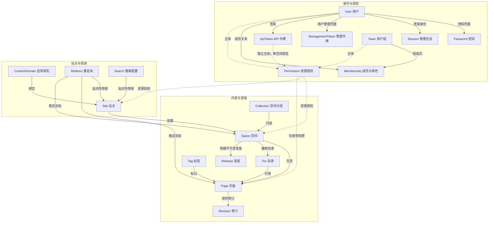
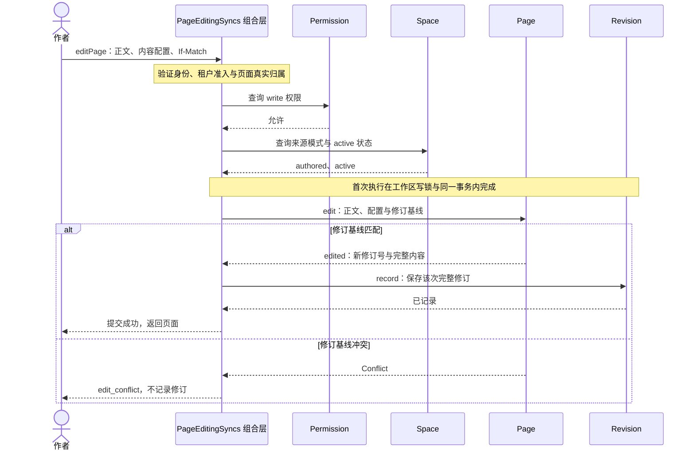
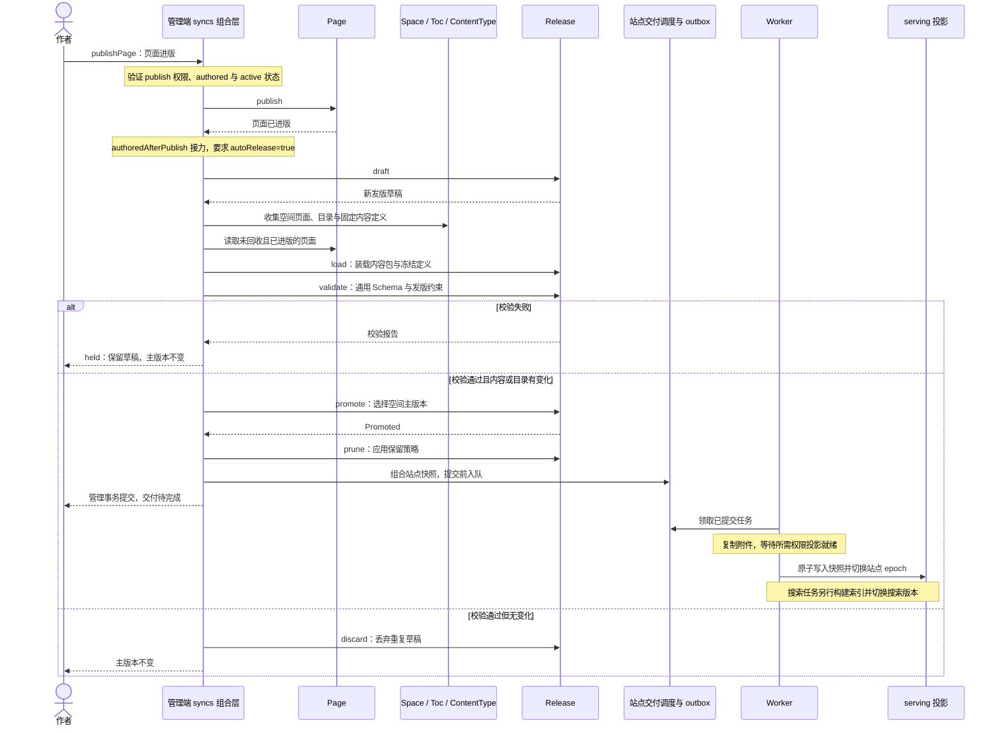
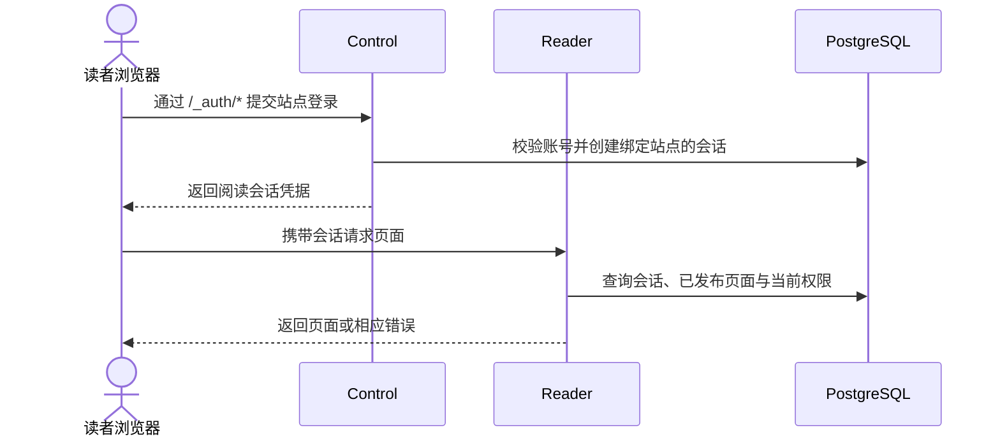
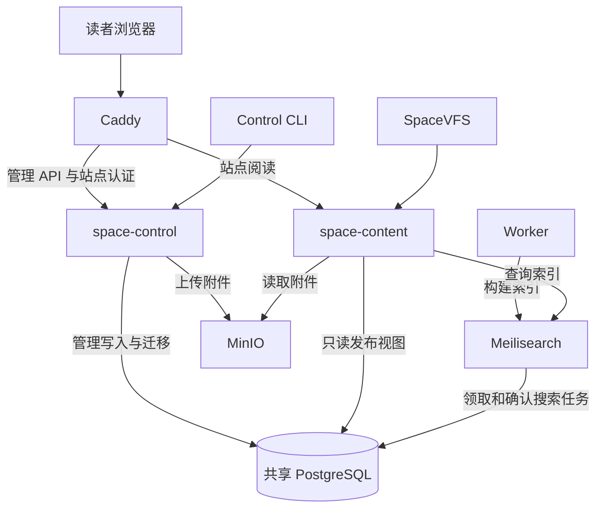

# Edition

Edition 是多租户文档与知识交付平台。维护者在空间内创作或导入内容。平台通过发版，向读者和应用智能体提供已上线内容。

Manage content in spaces. Publish versions for readers and application agents.

**版本 1.3.0** · [版本说明](CHANGELOG.md) · [文档导航](docs/README.md) · [Apache-2.0](LICENSE)

## 界面预览

**发布后的文档站点** · 读者可以搜索文档、浏览空间目录，并通过右侧页内目录跳转到章节。


## 项目概述

- **维护内容**：编辑多格式页面。管理目录、附件、标签和修订。
- **导入内容**：接收外部文档包。外部同步空间支持紧急热修和漂移确认。
- **发布内容**：校验内容并生成不可变发版。选择空间主版本，或回滚到归档发版。
- **托管站点**：挂载空间，接入自有域名，维护重定向。读者通过目录和搜索查找内容。
- **控制访问**：隔离租户数据。通过成员、用户组和资源授权控制操作。页面权限只能收窄。
- **接入智能体**：使用 Control CLI 和技能维护内容。使用只读接口或 SpaceVFS 读取线上内容。

[PRD](docs/prd/README.md)定义产品范围与验收要求。[ADR](docs/adr/README.md)记录架构决策与实现依据。独立插件工程和 MCP Apps 尚未交付，见[后续方向](docs/prd/README.md#plugin-roadmap)。

### 概念关系图

箭头表示业务关联，标签说明关系。跨概念流程由 syncs 组合。图中不表示 Java 模块的直接调用依赖。



资源管理与授权受租户边界约束。User 是全局账号。Membership 分别承载租户成员和用户组成员关系。ApiToken 绑定单一租户和空间，授权不继承签发人的权限。ManagementToken 仍代表用户。

概念定义与类型参数见[组合根](backend/apps/control/src/main/java/io/space/control/compositions/SYNCS.md)。平台扩展概念见 [PRD 概念索引](docs/prd/README.md)。

## 环境要求

| 任务 | 宿主机要求 |
| --- | --- |
| 启动完整本地平台 | Git、Node.js 24、Corepack、Docker Linux 容器引擎、Compose ≥2.24.4 |
| 开发前端 | Node.js 24。仓库固定使用 pnpm 11.10.0 |
| 构建后端 | 本机 JDK 和仓库 Gradle Wrapper。仓库配置 Java 25 编译工具链 |
| 在宿主机运行后端或 CLI | Java 25 |
| 执行浏览器验收 | Java 25、三个后端 JAR、前端依赖、Chromium、Docker |
| 使用 SpaceVFS 或执行 VFS 验收 | Python ≥3.11。消费适配依赖见[安装说明](clients/space/README.md#安装) |

完整平台在容器内构建前后端。容器同时运行数据库、对象存储、搜索和邮件服务。因此，仅启动平台时，宿主机无需安装 Java、PostgreSQL 或 MinIO。

首次构建需要访问依赖仓库和镜像仓库。macOS 和 Windows 可使用 Docker Desktop。Linux 使用 Docker Engine。配置说明见[运行手册](docs/tech/DELIVERY.md)。

## 安装与本地启动

1. 获取仓库。进入仓库根目录。

   ```bash
   git clone https://github.com/concept-git/edition.git
   cd edition
   ```

2. 安装启动工具依赖。

   ```bash
   cd infra
   corepack pnpm install --frozen-lockfile
   cd ..
   ```

3. 检查运行环境。

   ```bash
   node infra/space.ts platform doctor
   ```

4. 启动平台。

   ```bash
   node infra/space.ts platform start
   ```

`start` 构建三个后端应用和前端。启动器等待服务就绪，再补齐演示数据。默认项目名为 `dw-platform`。

| 入口 | 地址或凭据 |
| --- | --- |
| 演示账号 | `owner@dev.local` / `password1` |
| 公开阅读示例 | [http://docs.localhost:8095/docs/intro](http://docs.localhost:8095/docs/intro) |
| 管理 API | `http://localhost:8094` |

Reader 按站点 Host 选择内容。打开阅读示例时，使用表中的 `docs.localhost` 地址。演示账号和本地配置用于开发。正式部署要求见[部署契约](docs/tech/DELIVERY.md#部署契约)。

在仓库根目录执行以下命令。

| 操作 | 命令 |
| --- | --- |
| 查看状态 | `node infra/space.ts platform status` |
| 查看日志 | `node infra/space.ts platform logs` |
| 重新部署并启动 | `node infra/space.ts platform restart` |
| 停止服务并保留数据卷 | `node infra/space.ts platform stop` |

默认项目将密钥、PAT 和日志保存到 `.scratch/dw-v1/runtime/platform-dw-platform/`。Git 忽略这些运行文件。

其他实例使用 `--project <名称>`。该实例的启动、状态、日志、重启和停止命令必须使用同一个项目名。

## 基本使用

通过 [Control CLI](clients/control/USAGE.md) 或管理 API 维护空间、提交发版，并从站点域名检查阅读页面和搜索结果。

检查结果时，区分以下三个状态。

| 状态 | 含义 |
| --- | --- |
| 页面进版 | 该页面可被发版收录 |
| 空间主版本 | 管理端为该空间选择的发版 |
| 站点线上版本 | Reader 当前提供的内容版本 |

按任务选择接入方式。

| 任务 | 文档 |
| --- | --- |
| 通过 CLI 或智能体维护内容 | [Control CLI](clients/control/README.md)、[操作指南](clients/control/USAGE.md) |
| 将线上空间作为只读文件树读取 | [SpaceVFS](clients/space/README.md) |
| 集成管理或阅读接口 | [生成契约](contracts/README.md)、[Reader 资源接口](docs/tech/READER-RESOURCES.md) |

## 经典场景的概念同步图

以下时序图按“请求触发 → 前置查询 → 概念动作 → 完成接力”展示流程。syncs 是组合层，负责调用各概念。管理端接力使用同步 Java 调用栈。跨进程交付通过 outbox 与 Worker 执行。

### 场景一：保存正文并记录修订

本图使用站内创作空间。保存正文不会直接触发发版。



Revision 记录失败会回滚正文变更。保存与取回历史修订共用 `editAndRecord` 接力。规则与实现见[页面创作与修订](backend/apps/control/src/main/java/io/space/control/compositions/authoring/pageediting/SYNCS.md)。

### 场景二：页面进版、构建发版并交付站点

本图使用已挂载站点、开启自动发版的站内创作空间。手动构建在鉴权后进入同一发版流水线。



页面进版与发版校验是两个步骤。校验失败时，进版标记仍可提交。主版本晋升提交后可通过已验证域名阅读，访问仍取决于当前权限。流程依据见[发版同步规则](backend/apps/control/src/main/java/io/space/control/compositions/releases/release/SYNCS.md)与[站点交付同步规则](backend/apps/control/src/main/java/io/space/control/compositions/hosting/sitedelivery/SYNCS.md)。

### 场景三：登录读者访问已上线页面

Control 处理站点登录与会话写入。Reader 使用只读身份查询当前会话、发布内容与授权。



完整规则见 [Reader 同步规格](backend/apps/content/src/main/java/io/space/contentapp/SYNCS.md)。

## 系统架构与仓库结构

### 系统架构图



运行拓扑见[部署配置](infra/deployment/compose.yml)、[运行角色配置](infra/space.ts)和[交付架构](docs/tech/DELIVERY.md)。

### 插件架构图

内容类型定义固定解释规则。可信插件分别提供编辑贡献和呈现贡献。在线候选使用独立的开发与验证链路。

```mermaid
flowchart TB
  subgraph Production["生产内容链路"]
    Build["可信源码与构建"] --> Registry["可信插件 Registry"]
    Registry --> Editor["编辑贡献"]
    Registry --> Renderer["呈现贡献"]
    Type["ContentType 不可变定义版本"] -->|固定可信贡献引用| Registry
    Editor --> Mount["PluginMount 挂载 / 编辑会话"]
    Type -->|固定 versionRef 与解释| Value["内容值：content / versionRef / interpretation"]
    Mount -->|编辑与保存| Value
    Value --> PageRevision["Page / Revision 原子保存"]
    PageRevision --> Freeze["组合层冻结定义与摘要"]
    Type --> Freeze
    Freeze --> Release["Release：通用 Schema 准入与不可变发版"]
    Release -->|Worker 投影| Snapshot["SiteSnapshot 冻结快照"]
    Snapshot --> Read["独立 Reader"]
    Renderer -->|本地可信呈现包| Read
  end
  subgraph Development["在线开发与验证"]
    Draft["PluginDevelopment 开发稿"] --> Compile["浏览器 Worker / esbuild-wasm 编译"]
    Compile --> Candidate["PluginDevelopment 固定候选与摘要"]
    Candidate --> Sandbox["隔离 iframe：运行与浏览器验证"]
    Candidate -->|样例与定义版本| Server["服务端独立 Schema 验证"]
    Sandbox --> Evidence["PluginVerification 验证证据"]
    Server --> Evidence
    Evidence --> Export["导出固定候选与匹配报告"]
  end
```



ContentType 保存定义与可信实现引用。新可执行实现需经过审核，并随可信构建发布。候选通过验证不会自动安装到生产。Reader 只加载呈现贡献，保留安全原文作为失败兜底。

候选隔离和验证流程见[内容插件工程](docs/tech/CONTENT-PLUGINS.md)。

### 仓库结构

| 目录 | 职责 |
| --- | --- |
| `backend/apps/control` | 管理账号事实、授权、创作和发版。管理产物名为 `space` |
| `backend/apps/index` | 重建搜索索引 |
| `backend/apps/content` | 提供已发布内容 |
| `backend/libraries/contract` | 定义被动跨进程契约 |
| `acceptance` | 阅读和交付的浏览器验收 |
| `clients/control` | 提供独立管理 CLI |
| `clients/space` | 提供 Python SpaceVFS 消费适配 |
| `contracts` | 保存生成的 OpenAPI 和正文格式契约 |
| `features` | 保存 Gherkin 应用验收场景 |
| `infra` | 管理启动、隔离验收、部署和仓库检查 |
| `docs` | 保存产品需求、架构决策和工程文档 |

后端在概念和流程目录中共置行为规格。模块检查使用 Modulith、ArchUnit 和 ESLint。详细说明见 [STACK](docs/tech/STACK.md) 和 [BDD 行为规格](features/README.md)。

## 开发与测试

测试与质量看护统一从 `node infra/space.ts quality` 进入。工具链准备、90% 覆盖率门槛、零告警规则与报告位置见[质量看护说明](infra/quality.md)。首次先执行 `node infra/space.ts quality coverage --measure` 定位差距，再执行正式门禁。测量完成不表示覆盖率已达标。

[BDD 行为规格](features/README.md)按业务上下文组织，同时作为应用验收标准和项目阅读入口。每个场景有稳定编号，并关联共置规格、步骤实现与执行套件。

在仓库根目录构建后端。集成测试需要可用的 Docker 引擎和真实 PostgreSQL。

```bash
./backend/gradlew --project-dir backend build
```

Windows 使用 `backend\gradlew.bat --project-dir backend build`。定向运行后端任务时，写完整项目路径，例如 `:control:test`。

执行浏览器验收前，先完成前后端构建。然后安装 Chromium。

```bash
cd acceptance
corepack pnpm install --frozen-lockfile
corepack pnpm exec playwright install chromium
cd ..
```

在仓库根目录依次执行三组验收。三组验收共用端口和数据，不能并行运行。

```bash
node infra/space.ts verify delivery
node infra/space.ts verify private
node infra/space.ts verify vfs
```

已有本地平台运行时，先设置[隔离验收配置](docs/tech/TESTING.md#本地与-ci-使用同一独立拓扑)。三组验收使用相同的项目名、端口偏移、存储命名空间和运行目录。故障场景与结果位置见 [TESTING](docs/tech/TESTING.md)。

修改文档、目录或脚本入口后，执行仓库检查。

```bash
node infra/space.ts repository
```

## 常见问题

| 问题 | 处理方法 |
| --- | --- |
| Docker 不可用 | 启动 Linux 容器引擎。执行 `doctor` 检查。安装步骤见[运行手册](docs/tech/DELIVERY.md#本地启动) |
| 端口已被占用 | 停止旧项目，或按下方示例启动独立实例 |
| 旧数据库迁移校验失败 | 保留旧数据卷。停止旧项目。用新的 `--project` 创建平台实例。隔离验收改用新的 `E2E_STORAGE_NAMESPACE` |
| JAR 或 CLI 提示 Java 版本不符 | 将终端的 Java 切换到 Java 25。Gradle 编译工具链不会替换终端的 Java |
| 发版后仍读到旧内容 | 检查站点交付状态和 Worker 日志。空间主版本已更新，不表示所有站点均已上线 |

以下示例创建 `dw-demo` 实例。各端口增加 1000。

```bash
node infra/space.ts platform start --project dw-demo --port-offset 1000
node infra/space.ts platform status --project dw-demo
node infra/space.ts platform stop --project dw-demo
```

迁移校验失败时，不要清空已有数据卷，也不要跳过校验。恢复要求见[迁移决策](docs/adr/README.md#adr-0025)。

## 贡献与支持

在 [GitHub Issues](https://github.com/concept-git/document-space/issues) 报告问题。附上复现步骤、预期结果、实际结果和脱敏日志。

提交改动前，完成以下步骤。

1. 阅读 [AGENTS.md](AGENTS.md) 和对应分区规范。
2. 行为变更时，更新共置规格。
3. 接口变更时，按[契约说明](contracts/README.md)重新生成契约。将契约与实现一起提交。
4. 执行与改动相关的检查。
5. 确认待提交文件不含凭据、运行数据和构建缓存。

文档的权威边界见[文档导航](docs/README.md)。术语以 [CONTEXT](CONTEXT.md) 为准。

## 许可证

本项目采用 [Apache License 2.0](LICENSE)。

博客消费端与同机部署说明见 [reading](reading/README.md)。
